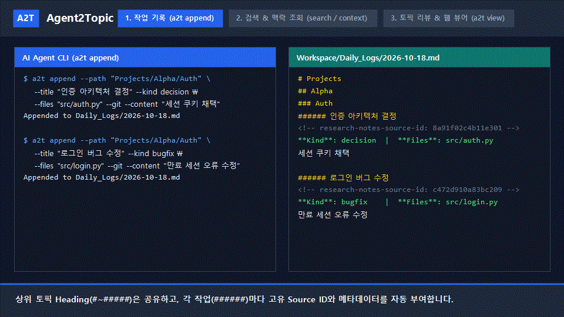
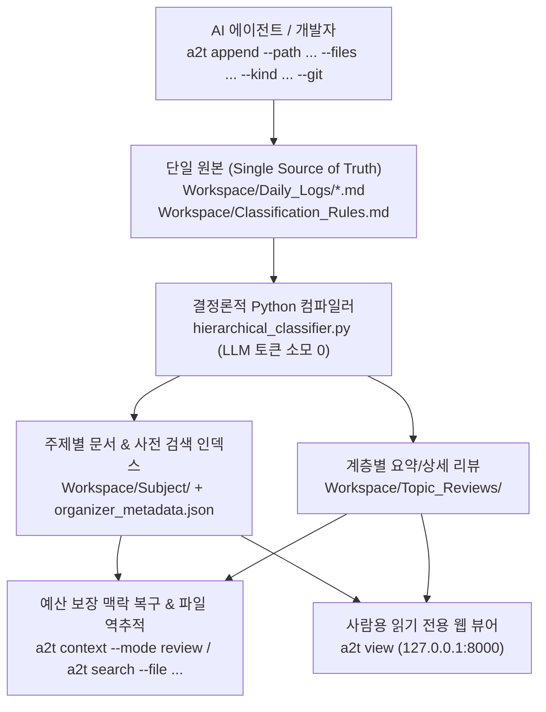

# Agent2Topic

[English](README.md) · **한국어**

[](https://github.com/Rubidius37/Agent2Topic/actions/workflows/ci.yml)
[](https://github.com/Rubidius37/Agent2Topic/releases)
[-0f766e)](pyproject.toml)
[](LICENSE)

**시간순으로 기록하고 주제(Topic)·파일별 맥락으로 복구하는 AI 에이전트 & 개발자 겸용 Markdown 작업 이력 컴파일러**

AI 코딩·연구 에이전트(Codex, Claude Code, OpenCode)가 여러 세션에 걸쳐 프로젝트를 진행할 때, 단일 메모리 파일(`MEMORY.md`)에 모든 내용을 계속 덧붙이면 컨텍스트 윈도우가 금방 넘치고, 벡터 DB를 쓰면 시간순 인과관계(*"지난주에 왜 A 설계를 버리고 B로 바꿨는가?"*)와 원문 출처가 사라집니다.

**Agent2Topic (`a2t`)**은 에이전트가 날짜별로 남긴 작업 기록(`Daily_Logs/`)을 **LLM 토큰 소모 없이 결정론적 Python 규칙 엔진**으로 분류하여 주제별 문서(`Subject/`), 연대기 리뷰(`Topic_Reviews/`), 사전 검색 인덱스로 컴파일합니다.

[왜 만들었나](#왜-만들었나) · [동작 흐름](#동작-흐름) · [기존 방식과의 비교](#기존-방식과의-비교) · [빠른 시작](#빠른-시작) · [CLI 명령어](#cli-명령어-요약) · [에이전트 규약 (`AGENTS.md`)](AGENTS.md)

---

## 왜 만들었나

날짜별로 쓴 연구·개발 일지를 주제별로 다시 읽기 위해 [Log2Topic](https://github.com/Rubidius37/Log2Topic)을 만들어 사용하면서, **특정 마크다운 편집기나 플러그인에 종속되지 않는 표준 파일 구조**가 주는 장점을 크게 체감했습니다. 일반 마크다운 파일로 결과가 구체화되어 있으면 어떤 환경에서든 도구를 가리지 않고 읽고 쓸 수 있기 때문입니다.

이후 코딩과 연구에 AI 에이전트(Codex, Claude Code, OpenCode 등)를 본격적으로 활용하면서 똑같은 필요성을 느꼈습니다. 에이전트가 세션마다 쏟아내는 설계 결정, 디버깅 원인 분석, 실험 결과들도 시간순으로 흩어지는데, **에이전트가 다양하게 남기는 기록들도 연구 기록과 마찬가지로 주제(Topic)별로 모아서 보고 다음 작업에서 바로 맥락을 복구하게 만들고 싶었습니다.**

그래서 `Log2Topic`의 결정론적 분류·리뷰 엔진을 바탕으로, 에이전트가 직접 CLI(`agent2topic` / `a2t`)로 개별 작업 이벤트(`Entry`)를 기록·검색하고, 사람도 마크다운 편집기나 내장 웹 뷰어(`a2t view`)로 언제든 주제별 흐름을 함께 확인할 수 있는 **`Agent2Topic`**을 만들었습니다.

---

## 동작 흐름

<p align="center">
  
</p>



1. **토픽 계층(`#`~`#####`) 공유 + 개별 작업 이벤트(`######`) 독립 식별**:
   - 같은 날짜·같은 토픽에 연속 기록할 때 상위 `#`~`#####` 토픽 Heading은 중복 작성하지 않으면서, 각 `###### <제목>` 작업 이벤트(`Entry`)마다 고유 `Source ID`, `Kind`, `Files`, `Commit`, `Agent`, `Session` 메타데이터를 독립적으로 보존합니다.
2. **파일 경로·종류·커밋 기반 즉시 역추적 (`a2t search`)**:
   - 에이전트가 토픽 이름을 몰라도 지금 수정할 파일(`--file "src/login.py"`), 기록 종류(`--kind bugfix`), 커밋(`--commit`)으로 과거 기록과 관련 `Topic_Reviews` 경로를 즉시 찾습니다 (4,000자 이하 기록은 디스크 접근 없이 메모리 인덱스에서 즉시 응답하며, 4,000자 초과 기록은 자동으로 원문 전문까지 확인).
3. **JSON 전체 출력 길이가 엄격히 보장되는 Bounded Context (`a2t context`)**:
   - `--mode index|review|entries`와 `--max-chars`(기본 `12000`)를 통해 직렬화된 JSON 전체 크기가 예산을 절대 넘지 않도록 보장하며, 남은 항목은 `--offset`(`has_more`, `next_offset`)으로 페이지네이션합니다.
4. **사람을 위한 순수 읽기 전용 로컬 웹 뷰어 (`a2t view`)**:
   - Obsidian/VS Code뿐 아니라 `a2t view` 명령 한 줄로 브라우저에서 폴더 트리, 문서 내 목차(TOC), 상대 링크 이동을 확인할 수 있으며, 브라우저 탭을 모두 닫으면 3초 후 서버가 자동 종료됩니다.

---

## 기존 방식과의 비교

| 방식 | 컨텍스트 비용 | 시간순 인과관계 | 출처 추적 (`Source ID` + Git SHA) | 편집기 / 외부 서비스 종속 |
| :--- | :--- | :--- | :--- | :--- |
| **단일 `MEMORY.md` / `CLAUDE.md`** | 기록이 쌓일수록 컨텍스트 폭발 | 여러 주제가 한 파일에 뒤섞임 | 없음 | 없음 |
| **Vector DB / 임베딩 메모리** | 임베딩 API 및 DB 필요 | 손실됨 (유사도 검색 $\neq$ 시간순 흐름) | 불투명한 청크 단위 | 벡터 DB 종속 |
| **Obsidian 플러그인 (Dataview 등)** | 사람용 GUI 전용 | 플러그인 쿼리에 의존 | 제목 변경 시 연결 끊김 | Obsidian 앱 필수 |
| **Agent2Topic (`a2t`)** | **`--max-chars` 엄격 보장 & 분류 시 LLM 토큰 0** | **토픽별 연대기 리뷰(`Topic_Reviews/`)로 보존** | **영구 `Source ID` + `Files` + `Commit` + `Agent`** | **100% 표준 Markdown + Python 표준 라이브러리** |

---

## 빠른 시작

**요구 사항**: Python 3.10 이상 (외부 패키지 설치 불필요, 100% 표준 라이브러리).

### 1. 설치하기
```powershell
# 방법 A: uv 또는 pipx로 전역 설치 (권장)
uv tool install git+https://github.com/Rubidius37/Agent2Topic.git
# (또는: pipx install git+https://github.com/Rubidius37/Agent2Topic.git)

# 방법 B: 저장소 클론 및 편집 가능 설치
git clone https://github.com/Rubidius37/Agent2Topic.git
cd Agent2Topic
pip install -e .
```
설치 후 정식 명령어 `agent2topic`과 단축 별칭 **`a2t`**(또는 로컬 스크립트 `.\a2t.bat`, `./a2t.sh`)를 모두 사용할 수 있습니다.

### 2. 작업공간 초기화
```powershell
# 기본 Workspace 초기화 (외부 프로젝트 폴더에 만들 때는 --here 추가)
a2t init
```

### 3. 작업 이벤트 기록 및 자동 컴파일 (`a2t append`)
```powershell
a2t append `
  --path "Projects/Alpha/Auth" `
  --title "인증 아키텍처 결정" `
  --kind "decision" `
  --files "src/auth.py" `
  --git `
  --content "Stateless JWT 대신 HttpOnly 세션 쿠키 방식을 채택함." `
  --create-rule

a2t append `
  --path "Projects/Alpha/Auth" `
  --title "로그인 만료 세션 버그 수정" `
  --kind "bugfix" `
  --files "src/login.py" `
  --git `
  --content "만료된 세션에서 토큰 갱신 전 null 체크 누락 수정."
```

### 4. 파일 경로·키워드 검색 및 토픽 맥락 복구 (`a2t search` / `a2t context`)
```powershell
# 수정할 파일 경로와 기록 종류로 과거 이력 및 리뷰 경로 검색
a2t search --file "src/login.py" --kind "bugfix" --json

# 특정 토픽의 리뷰와 최근 엔트리를 12,000자 예산 내에서 조회
a2t context --topic "Projects/Alpha/Auth" --mode review --max-chars 12000 --json

# 특정 Source ID의 원문 전체가 필요할 때만 상세 조회
a2t source --id <SOURCE_ID> --json
```

### 5. 읽기 전용 로컬 웹 뷰어 열기 (`a2t view`)
```powershell
a2t view
```

---

## CLI 명령어 요약 (`a2t` / `agent2topic`)

| 명령어 | 설명 |
| :--- | :--- |
| `a2t init [--here] [--json]` | `Workspace/Daily_Logs/`, `attachments/`, `Classification_Rules.md` 초기 생성 |
| `a2t update [--dry-run] [--rebuild-ids] [--json]` | Python 분류기를 실행하여 `Subject/`, `Topic_Reviews/`, 검색 인덱스 갱신 |
| `a2t rules [--json]` | `Classification_Rules.md`의 5단계 카테고리 경로 및 키워드 목록 조회 |
| `a2t rule-add --path "..." [--keywords "..."] [--json]` | 규칙표에 새 카테고리 경로 행 자동 삽입 |
| `a2t append --path "..." [--title "..."] [--files "..."] [--kind "..."] [--git \| --commit "..."] [--agent "..."] [--session "..."] [--create-rule]` | 오늘 날짜 일지에 독립 `######` 작업 엔트리 추가 후 즉시 컴파일 |
| `a2t search [--query "..."] [--file "..."] [--kind "..."] [--commit "..."] [--agent "..."] [--session "..."] [--topic "..."] [--deep] [--max-chars 12000]` | 사전 구축된 인덱스에서 파일·키워드·종류·커밋·에이전트·토픽으로 검색 (4,000자 초과 기록 자동 원문 폴백) |
| `a2t context --topic "..." [--mode review\|index\|entries] [--max-chars 12000] [--limit 5] [--offset 0] [--json]` | 특정 토픽의 리뷰와 엔트리를 지정된 문자 예산 내에서 페이지네이션 조회 |
| `a2t status [--json]` | 분류 통계 및 미분류(`needs_review`) 항목 확인 |
| `a2t classify --source-id <ID> --path "..."` | 특정 `Source ID`에 수동 `Category:` 지정 또는 해제(`--clear-manual`) |
| `a2t source --id <ID> [--max-chars N] [--json]` | 특정 `Source ID`의 원본 일지 위치, 메타데이터, 본문 전문 역추적 |
| `a2t view [--port 8000] [--refresh]` | 사람 열람용 순수 읽기 전용 로컬 웹 뷰어 실행 |
| `a2t version [--check] [--json]` | 현재 버전 확인 및 GitHub 최신 릴리스 수동 조회 |

---

## 업데이트 방법

사용자 데이터(`Workspace/`)와 프로그램 코드가 분리되어 있으므로 도구를 업데이트해도 일지나 분류 규칙은 절대 덮어써지지 않습니다.
```powershell
# uv / pipx 설치 사용자
uv tool upgrade agent2topic
pipx upgrade agent2topic

# git clone 설치 사용자
git pull --ff-only

# 새 릴리스가 나왔는지 수동 확인 (백그라운드 자동 실행 없음)
a2t version --check
```

---

## 테스트 실행

```powershell
python -B -m unittest discover -s tests
```

## 라이선스

이 프로젝트는 [GNU General Public License v3.0 (GPL-3.0)](LICENSE)로 배포됩니다.
