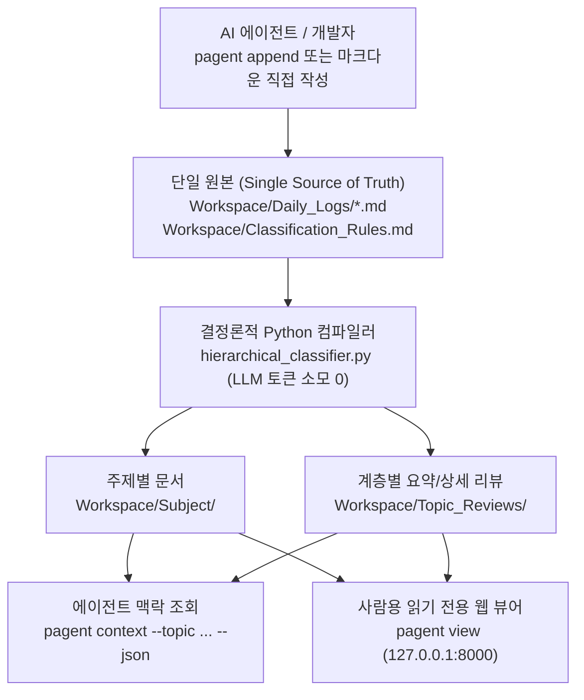

# Project_Agent

[English](README.md) · **한국어**

**시간순으로 기록하고 주제별 맥락으로 복구하는 AI 에이전트 & 개발자 겸용 Markdown 작업 이력 컴파일러**

AI 코딩·연구 에이전트(Codex, Claude Code, OpenCode)가 여러 세션에 걸쳐 프로젝트를 진행할 때, 단일 메모리 파일(`MEMORY.md`)에 모든 내용을 계속 덧붙이면 컨텍스트 윈도우가 금방 넘치고, 벡터 DB를 쓰면 시간순 인과관계(*"지난주에 왜 A 설계를 버리고 B로 바꿨는가?"*)와 원문 출처가 사라집니다.

**Project_Agent**는 **LLM 토큰 소모 없이 결정론적 Python 분류 엔진**으로 이 문제를 해결합니다:
1. **에이전트(또는 사람)가 날짜별 원본 일지(`Workspace/Daily_Logs/`)에 작업 기록을 추가**합니다.
2. **Python 규칙 기반 분류기**가 영구 `Source ID`로 각 기록 구간을 추적하며 주제별 상세 문서(`Workspace/Subject/`)와 컨텍스트 길이가 통제된 연대기 리뷰(`Workspace/Topic_Reviews/`)를 자동 컴파일합니다.
3. **사람은 언제든** Obsidian, VS Code 또는 내장된 **읽기 전용 로컬 웹 뷰어(`pagent view`)**로 폴더 트리와 렌더링된 마크다운을 편하게 열람할 수 있습니다.

---

## 동작 구조



### 핵심 설계 원칙
- **분류·컴파일 시 LLM 토큰 소모 0**: 문서 분류, 구간 병합, 상대 링크 재계산, 리뷰 생성은 외부 API나 LLM 호출 없이 100% Python 표준 라이브러리로 즉시 수행됩니다.
- **영구 `Source ID` 출처 추적**: 각 기록 구간에 `<!-- research-notes-source-id: ... -->` 주석을 부여해 제목이나 분류 경로가 바뀌어도 파생 문서를 정확히 갱신하고 원본 일지로 역추적합니다.
- **에이전트 본문 Heading 자동 보호**: `pagent append`로 기록할 때 본문 내부의 `#`~`#####` Heading을 자동으로 `######`으로 변환하여 분류 경계가 깨지는 문제를 원천 차단합니다.
- **읽기 전용 로컬 웹 뷰어 (`pagent view`)**: 별도 마크다운 편집기를 열지 않아도 브라우저에서 폴더 트리 탐색과 Markdown HTML 렌더링, 문서 간 상대 링크 이동을 확인할 수 있으며, 브라우저 탭을 모두 닫으면 3초 후 서버가 자동 종료됩니다.

---

## 빠른 시작

**요구 사항**: Python 3.10 이상 (외부 패키지 설치 불필요, 100% 표준 라이브러리).

### 1. 작업공간 초기화
```powershell
# Windows
.\pagent.bat init

# Linux / macOS
./pagent.sh init
```

### 2. 분류 규칙 조회 및 추가
```powershell
# 현재 5단계 분류 규칙 트리 확인
.\pagent.bat rules

# 새 카테고리 경로를 Classification_Rules.md 표에 추가
.\pagent.bat rule-add --path "Projects/CoreEngine/Parser" --keywords "parser, ast"
```

### 3. 작업 기록 추가 및 자동 컴파일 (`append`)
```powershell
.\pagent.bat append `
  --path "Projects/CoreEngine/Parser" `
  --title "코드 블록 경계 파싱 수정" `
  --content "물결표(~~~) 코드 블록 내부의 Heading이 분리되지 않도록 수정함." `
  --create-rule
```
오늘 날짜의 `Workspace/Daily_Logs/YYYY-MM-DD.md`에 기록을 추가하고 즉시 Python 분류기를 실행하여 `Subject/`와 `Topic_Reviews/`를 갱신합니다.

### 4. 토픽별 과거 맥락 조회 (`context`)
```powershell
.\pagent.bat context --topic "Projects/CoreEngine" --limit 5 --json
```

### 5. 읽기 전용 로컬 웹 뷰어 열기 (`view`)
```powershell
.\pagent.bat view
```
`http://127.0.0.1:8000`에서 좌측 폴더 트리(`Topic_Reviews`, `Subject`, `Daily_Logs`, `Classification_Rules.md`)와 우측 Markdown HTML 렌더링 화면이 열립니다. 모든 브라우저 탭을 닫으면 3초 뒤 로컬 서버가 자동으로 종료됩니다.

---

## CLI 명령어 요약

| 명령어 | 설명 |
| :--- | :--- |
| `pagent init` | `Workspace/Daily_Logs/`, `attachments/`, `Classification_Rules.md` 초기 생성 |
| `pagent update [--dry-run] [--rebuild-ids]` | Python 분류기를 실행하여 `Subject/` 및 `Topic_Reviews/` 갱신 |
| `pagent rules [--json]` | `Classification_Rules.md`의 5단계 카테고리 경로 및 키워드 목록 조회 |
| `pagent rule-add --path "..." [--keywords "..."]` | 규칙표에 새 카테고리 경로 행 자동 삽입 |
| `pagent append --path "..." [--title "..."] [--content "..." \| --stdin] [--create-rule]` | 오늘 날짜 일지에 기록 추가(본문 내 `#`~`#####` 자동 강등) 후 즉시 컴파일 |
| `pagent context --topic "..." [--limit N] [--json]` | 특정 토픽의 `Topic_Reviews/` 문서와 최근 N건 기록 조회 |
| `pagent status [--json]` | 분류 통계 및 미분류(`needs_review`) 항목 확인 |
| `pagent classify --source-id <ID> --path "..."` | 특정 `Source ID`에 수동 `Category:` 지정 또는 해제(`--clear-manual`) |
| `pagent source --id <ID> [--json]` | 특정 `Source ID`의 원본 일지 위치 및 본문 전문 역추적 |
| `pagent view [--port 8000]` | 사람 열람용 읽기 전용 로컬 웹 뷰어 실행 |

---

## 테스트 실행

```powershell
python -B -m unittest discover -s tests
```

## 라이선스

이 프로젝트는 [GNU General Public License v3.0 (GPL-3.0)](LICENSE)로 배포됩니다.
