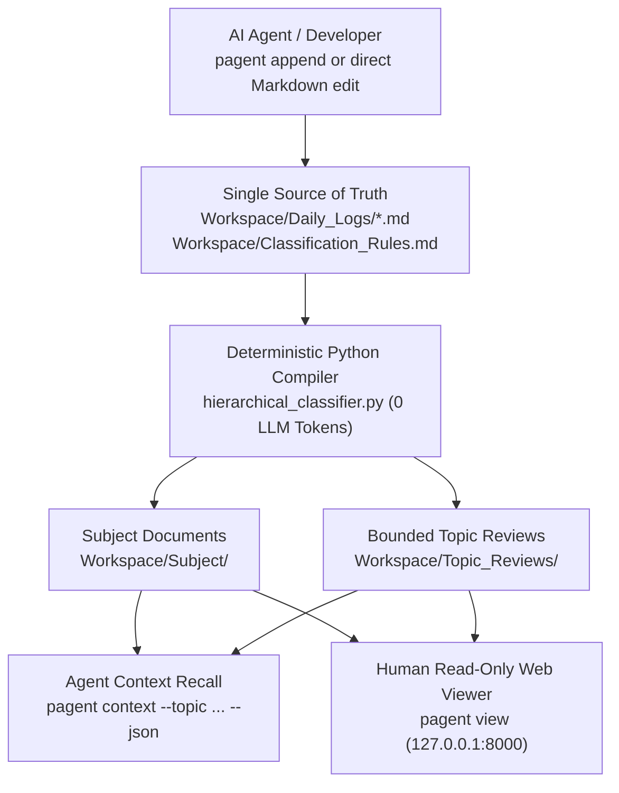

# Project_Agent

**English** · [한국어](README.ko.md)

**Agents Work by Time, Reason by Topic — A Deterministic Markdown Work-History Compiler for AI Agents & Humans**

When AI coding or research agents (Codex, Claude Code, OpenCode) work across multiple sessions, appending everything to a single memory file quickly blows up the context window, while vector databases lose chronological causality (*"Why did we switch from approach A to B last week?"*).

**Project_Agent** solves this with **zero LLM token overhead**:
1. **Agents (or humans) append chronological work logs** to `Workspace/Daily_Logs/`.
2. **A deterministic Python rule engine** tracks every section with a permanent `Source ID` and compiles topic-specific documents (`Workspace/Subject/`) and context-budgeted chronological reviews (`Workspace/Topic_Reviews/`).
3. **Humans inspect the workspace** anytime via Obsidian, VS Code, or the built-in **Read-Only Local Web Viewer (`pagent view`)**.

---

## Core Architecture



### Why Deterministic Python Compilation?
- **Zero LLM Tax for Organization**: Categorization, section merging, relative link rewriting, and review budgeting run in milliseconds via pure Python stdlib—no secondary LLM calls or API keys required.
- **Permanent `Source ID` Provenance**: Every log section receives a persistent HTML comment (`<!-- research-notes-source-id: ... -->`). Even if headings are renamed or reorganized, derived files reconcile cleanly and every review excerpt links back to the exact daily log.
- **Heading Boundary Protection**: When an AI agent logs work via `pagent append`, any `#`–`#####` headings inside the body are automatically demoted to `######` so agent formatting never splits classification boundaries.
- **Bounded Context Budgets**: `Topic_Reviews/` enforces strict character budgets per hierarchy depth (Level 1 Index: 8 KB, Level 2 Overview: 12 KB, Level 3–5 Detail: 18 KB), allowing agents to load topic history without context overflow.

---

## Quick Start

**Requirements**: Python 3.10+ (100% Python standard library; no `pip install` needed).

### 1. Initialize Workspace
```bash
# Windows
.\pagent.bat init

# Linux / macOS
./pagent.sh init
```

### 2. Inspect or Add Classification Rules
```bash
# List current 5-level category tree
.\pagent.bat rules

# Add a new category path to Workspace/Classification_Rules.md
.\pagent.bat rule-add --path "Projects/CoreEngine/Parser" --keywords "parser, ast"
```

### 3. Append a Work Log Entry (Agent or CLI)
```bash
.\pagent.bat append ^
  --path "Projects/CoreEngine/Parser" ^
  --title "Fix fenced code block boundary detection" ^
  --content "Updated source_lines_with_code_context to handle tilde fences." ^
  --create-rule
```
This writes the entry to `Workspace/Daily_Logs/YYYY-MM-DD.md` and immediately compiles `Workspace/Subject/` and `Workspace/Topic_Reviews/`.

### 4. Retrieve Topic Context (for AI Agents)
```bash
.\pagent.bat context --topic "Projects/CoreEngine" --limit 5 --json
```

### 5. Browse in the Read-Only Web Viewer (for Humans)
```bash
.\pagent.bat view
```
Opens `http://127.0.0.1:8000` with a collapsible folder tree (`Topic_Reviews`, `Subject`, `Daily_Logs`, `Classification_Rules.md`), instant file filtering, and full Markdown HTML rendering with internal link navigation. Closing all browser tabs automatically stops the local server after 3 seconds.

---

## Workspace Layout

```text
Project_Agent/
├─ pagent.bat / pagent.sh            # Unified CLI launchers
├─ AGENTS.md                         # Drop-in instructions for Codex / Claude Code / OpenCode
├─ Workspace/                        # Open this folder in Obsidian, VS Code, or via `pagent view`
│  ├─ Classification_Rules.md        # 5-level inherited classification table
│  ├─ Daily_Logs/                    # Chronological source logs (Single Source of Truth)
│  ├─ Subject/                       # Compiled topic documents (auto-generated)
│  ├─ Topic_Reviews/                 # Compiled chronological reviews (auto-generated)
│  └─ attachments/                   # Local images and diagrams
├─ scripts/                          # Pure Python 3.10+ compiler, CLI, and read-only web viewer
└─ tests/                            # Automated unit test suite
```

---

## Running Tests

```bash
python -B -m unittest discover -s tests
```

## License

Distributed under the [GNU General Public License v3.0 (GPL-3.0)](LICENSE).
