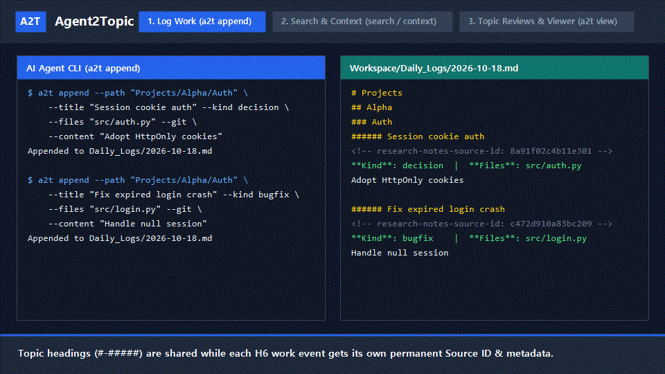
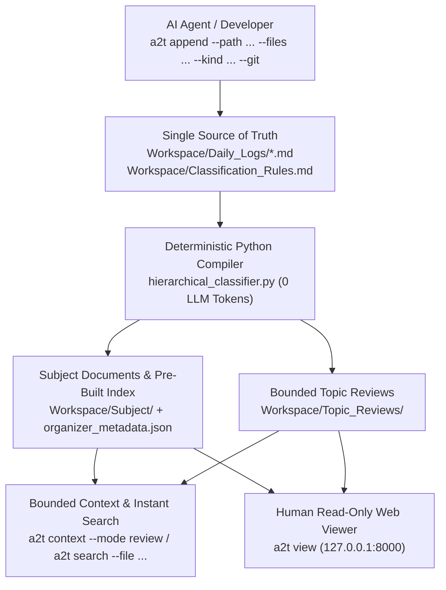

# Agent2Topic

**English** · [한국어](README.ko.md)

[](https://github.com/Rubidius37/Agent2Topic/actions/workflows/ci.yml)
[](https://github.com/Rubidius37/Agent2Topic/releases)
[-0f766e)](pyproject.toml)
[](LICENSE)

**Agents Work by Time, Reason by Topic — A Deterministic Markdown Work-History Compiler for AI Agents & Humans**

When AI coding or research agents (Codex, Claude Code, OpenCode) work across multiple sessions, appending everything to a single `MEMORY.md` quickly blows up the context window, while vector databases lose chronological causality (*"Why did we switch from approach A to B last week?"*).

**Agent2Topic (`a2t`)** compiles chronological agent work logs (`Daily_Logs/`) into structured topic documents (`Subject/`), bounded chronological reviews (`Topic_Reviews/`), and a pre-indexed metadata table—with **zero LLM token overhead** and **zero external dependencies**.

[Why Agent2Topic?](#why-agent2topic) · [How It Works](#how-it-works) · [Comparison](#how-does-it-compare) · [Quick Start](#quick-start) · [CLI Reference](#cli-reference) · [Agent Protocol (`AGENTS.md`)](AGENTS.md)

---

## Why Agent2Topic?

While building and using [Log2Topic](https://github.com/Rubidius37/Log2Topic) to organize daily research and engineering logs by topic, one of its biggest strengths was **not being locked into any specific Markdown editor or plugin ecosystem**. Because everything lived in standard Markdown files on disk, any tool could read and write them.

As AI agents (Codex, Claude Code, OpenCode) became a daily part of software engineering and research, the exact same problem surfaced: agents produce diverse records—architectural decisions, root-cause bug analyses, experiments, and refactors—that scatter across chronological sessions. **Just like human research notes, I wanted to gather the diverse records left by AI agents by topic (`Topic`), so both future agent sessions and humans can trace the complete history of any subject at a glance.**

**Agent2Topic** adapts `Log2Topic`'s deterministic 5-level rule engine into an agent-native CLI (`agent2topic` / `a2t`) with discrete H6 work-event (`Entry`) tracking, instant file/commit/kind search, strictly bounded context budgets (`--max-chars`), and a built-in read-only web viewer (`a2t view`).

---

## How It Works

<p align="center">
  
</p>



1. **Topic Hierarchy (`#`–`#####`) + Discrete Work Event Identity (`######`)**:
   - In `Daily_Logs/YYYY-MM-DD.md`, `#` through `#####` represent the 1–5 level **Topic** path (shared without repetition across same-day entries), while each `a2t append` writes a `###### <Title>` **Entry** with its own permanent `Source ID`, `Kind`, `Files`, `Commit`, `Agent`, and `Session` metadata.
2. **Pre-Indexed File, Kind & Commit Search (`a2t search`)**:
   - Coding agents often know the file they are editing (`src/login.py`), not the topic name. `a2t search --file "src/login.py"` queries the pre-built index in milliseconds (with automatic full-text fallback for entries > 4,000 chars) and returns matching entries plus their related `Topic_Reviews` paths.
3. **Strictly Bounded Context (`a2t context`)**:
   - Enforces a hard ceiling on the serialized JSON output (`--max-chars`, default `12000`) with built-in pagination (`--offset`, `returned_entries`, `has_more`, `next_offset`) across three modes: `index`, `review`, and `entries`.
4. **Human Audit via Obsidian, VS Code, or Read-Only Web Viewer (`a2t view`)**:
   - Humans can open `Workspace/` in any Markdown editor or run `a2t view` to browse the folder tree, on-page TOC, and rendered Markdown in a local browser.

---

## How Does It Compare?

| Approach | Context Cost | Chronological Causality | Provenance (`Source ID` + Git SHA) | Editor / Cloud Lock-in |
| :--- | :--- | :--- | :--- | :--- |
| **Single `MEMORY.md` / `CLAUDE.md`** | Grows unbounded; overflows context | Mixed topics in one flat file | None | None |
| **Vector DB / Embedding Memory** | Requires embedding API / DB | Lost (similarity $\neq$ timeline) | Opaque chunks | Requires vector store |
| **Obsidian Plugins (Dataview / Mover)** | Manual UI only | Plugin-dependent queries | Breaks on heading rename | Locked to Obsidian GUI |
| **Agent2Topic (`a2t`)** | **Strictly bounded (`--max-chars`) & 0 LLM tokens to compile** | **Preserved per Topic (`Topic_Reviews/`)** | **Permanent `Source ID` + `Files` + `Commit` + `Agent`** | **100% Plain Markdown + Python stdlib** |

---

## Quick Start

**Requirements**: Python 3.10+ (100% Python standard library; zero external dependencies).

### 1. Install
```bash
# Option A: Install globally via uv or pipx (Recommended)
uv tool install git+https://github.com/Rubidius37/Agent2Topic.git
# (or: pipx install git+https://github.com/Rubidius37/Agent2Topic.git)

# Option B: Clone and editable install
git clone https://github.com/Rubidius37/Agent2Topic.git
cd Agent2Topic
pip install -e .
```
Both `agent2topic` and the short alias `a2t` (as well as `./a2t.bat` and `./a2t.sh`) are available.

### 2. Initialize a Workspace
```bash
# Initialize bundled Workspace (or pass --here inside any external project repository)
a2t init
```

### 3. Append Work Events (`a2t append`)
```bash
a2t append \
  --path "Projects/Alpha/Auth" \
  --title "Session cookie architecture" \
  --kind "decision" \
  --files "src/auth.py" \
  --git \
  --content "Adopted HttpOnly session cookies instead of stateless JWT." \
  --create-rule

a2t append \
  --path "Projects/Alpha/Auth" \
  --title "Fix expired login crash" \
  --kind "bugfix" \
  --files "src/login.py" \
  --git \
  --content "Handled null session state before token refresh."
```

### 4. Search & Recall Bounded Context (`a2t search` / `a2t context`)
```bash
# Find past bugfixes or decisions touching a specific file
a2t search --file "src/login.py" --kind "bugfix" --json

# Retrieve bounded topic review (strictly capped at --max-chars)
a2t context --topic "Projects/Alpha/Auth" --mode review --max-chars 12000 --json

# Fetch full untruncated text of a specific Source ID when needed
a2t source --id <SOURCE_ID> --json
```

### 5. Browse in the Read-Only Web Viewer (`a2t view`)
```bash
a2t view
```
Opens `http://127.0.0.1:8000` with folder tree navigation, real-time filtering, on-page TOC, and Markdown HTML rendering. Closing all browser tabs automatically stops the server after 3 seconds.

---

## CLI Reference (`a2t` / `agent2topic`)

| Subcommand | Example | Description |
| :--- | :--- | :--- |
| `init` | `a2t init [--here] [--json]` | Initialize `Workspace/Daily_Logs/`, `attachments/`, and `Classification_Rules.md`. |
| `rules` | `a2t rules [--json]` | List all configured 1–5 level category paths and supplemental keywords. |
| `rule-add` | `a2t rule-add --path "Projects/Alpha/API" --keywords "rest, endpoint" [--json]` | Add a new topic path or keywords to the inherited table in `Classification_Rules.md`. |
| `append` | `a2t append --path "Projects/Alpha/API" --title "Auth fix" --kind bugfix --files "src/auth.py" --git --create-rule [--json]` | Append an independent `######` Entry to `Daily_Logs/YYYY-MM-DD.md` and run the Python classifier. |
| `search` | `a2t search [--query "..."] [--file "..."] [--kind "..."] [--commit "..."] [--agent "..."] [--session "..."] [--deep] [--max-chars 12000] [--json]` | Search pre-indexed entries (with automatic full-text fallback for >4,000 char entries). |
| `context` | `a2t context --topic "Projects/Alpha" [--mode review\|index\|entries] [--max-chars 12000] [--limit 5] [--offset 0] [--json]` | Return strictly bounded topic context with pagination (`returned_entries`, `has_more`, `next_offset`). |
| `update` | `a2t update [--dry-run] [--rebuild-ids] [--json]` | Run the deterministic Python classifier (`Daily_Logs/` → `Subject/` + `Topic_Reviews/`). |
| `status` | `a2t status [--json]` | Check classification statistics and any `needs_review` entries. |
| `classify` | `a2t classify --source-id <ID> --path "Projects/Alpha/API" [--json]` | Assign or clear a manual `Category:` override for a specific `Source ID`. |
| `source` | `a2t source --id <ID> [--max-chars N] [--json]` | Inspect the original log file, line number, metadata, and full content of a `Source ID`. |
| `view` | `a2t view [--port 8000] [--refresh]` | Launch the strictly read-only local web viewer (`http://127.0.0.1:8000`). |
| `version` | `a2t version [--check] [--json]` | Show installed version and manually check GitHub Releases for updates. |

---

## Updating

Because user data lives in `Workspace/` (ignored by Git and separate from the CLI package), updating the tool never modifies your logs or rules:
```bash
# If installed via uv / pipx
uv tool upgrade agent2topic
pipx upgrade agent2topic

# If installed via git clone
git pull --ff-only

# Manually check if a newer release exists on GitHub
a2t version --check
```

---

## Running Tests

```bash
python -B -m unittest discover -s tests
```

## License

Distributed under the [GNU General Public License v3.0 (GPL-3.0)](LICENSE).
