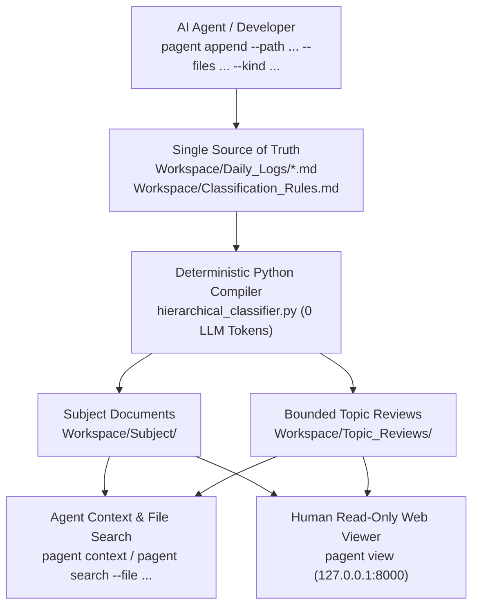

# Project_Agent

**English** · [한국어](README.ko.md)

**Agents Work by Time, Reason by Topic — A Deterministic Markdown Work-History Compiler for AI Agents & Humans**

When AI coding or research agents (Codex, Claude Code, OpenCode) work across multiple sessions, appending everything to a single memory file quickly blows up the context window, while vector databases lose chronological causality (*"Why did we switch from approach A to B last week?"*).

**Project_Agent** solves this with **zero LLM token overhead**:
1. **Agents (or humans) append chronological work logs** to `Workspace/Daily_Logs/` with optional `--files` and `--kind` tags.
2. **A deterministic Python rule engine** tracks every section with a permanent `Source ID` and compiles topic-specific documents (`Workspace/Subject/`) and context-budgeted chronological reviews (`Workspace/Topic_Reviews/`).
3. **Agents recall past context** by topic (`pagent context`) or by modified file path / keyword / kind (`pagent search`).
4. **Humans inspect the workspace** anytime via Obsidian, VS Code, or the built-in **Read-Only Local Web Viewer (`pagent view`)**.

---

## Core Architecture



### Key Capabilities
- **Zero LLM Tax for Organization**: Categorization, section merging, relative link rewriting, and review budgeting run in milliseconds via pure Python stdlib—no secondary LLM calls or API keys required.
- **File & Keyword Context Search (`pagent search`)**: Agents don't need to guess topic names. They can query past work by modified file (`--file "review_renderer.py"`), entry type (`--kind "decision"`), or keyword (`--query "atomic_write"`), including automatic detection of backticked file paths in prose.
- **Smart Same-Topic & Sibling Merging**: Multiple `append` calls on the same day under the same topic (or sibling topics) automatically avoid repeating redundant parent `#`–`#####` headings.
- **CWD-Aware & Installable (`pyproject.toml`)**: Install globally via `pip install -e .` (or `uv tool install .`) and run `pagent init --here` in any repository; `pagent` automatically discovers `Workspace/` from your current working directory.
- **Read-Only Local Web Viewer (`pagent view`)**: Includes a collapsible folder tree, `Needs Review` badge, Markdown HTML renderer, relative link routing, and an **On-Page Table of Contents (TOC)**.

---

## Quick Start

**Requirements**: Python 3.10+ (100% Python standard library; zero external dependencies).

```bash
# Optional: install `pagent` command into your Python environment
pip install -e .
```

### 1. Initialize Workspace
```bash
# Initialize bundled Workspace (or pass --here in any external project folder)
.\pagent.bat init
```

### 2. Append a Work Log Entry (Agent or CLI)
```bash
.\pagent.bat append ^
  --path "Projects/CoreEngine/Parser" ^
  --title "Fix fenced code block boundary detection" ^
  --kind "bugfix" ^
  --files "scripts/hierarchical_classifier.py" ^
  --content "Updated source_lines_with_code_context to handle tilde fences." ^
  --create-rule
```

### 3. Search by File, Kind, or Topic (for AI Agents)
```bash
# Find all past bugfixes or decisions touching a specific file
.\pagent.bat search --file "hierarchical_classifier.py" --json

# Retrieve the compiled chronological review for a topic
.\pagent.bat context --topic "Projects/CoreEngine" --limit 5 --json
```

### 4. Browse in the Read-Only Web Viewer (for Humans)
```bash
.\pagent.bat view
```
Opens `http://127.0.0.1:8000` with folder tree navigation, on-page TOC, and Markdown HTML rendering. Closing all browser tabs automatically stops the server after 3 seconds.

---

## Running Tests

```bash
python -B -m unittest discover -s tests
```

## License

Distributed under the [GNU General Public License v3.0 (GPL-3.0)](LICENSE).
