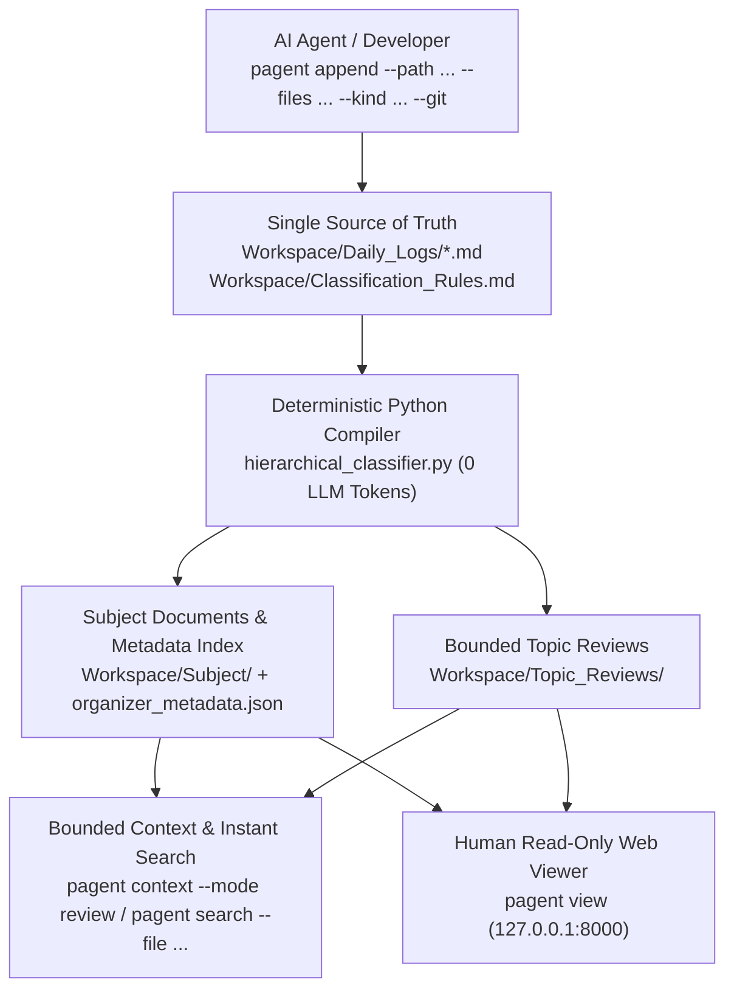

# Project_Agent

**English** · [한국어](README.ko.md)

**Agents Work by Time, Reason by Topic — A Deterministic Markdown Work-History Compiler for AI Agents & Humans**

When AI coding or research agents (Codex, Claude Code, OpenCode) work across multiple sessions, appending everything to a single memory file quickly blows up the context window, while vector databases lose chronological causality (*"Why did we switch from approach A to B last week?"*).

**Project_Agent** solves this with **zero LLM token overhead**:
1. **Agents (or humans) append discrete work events (`Entries`)** to `Workspace/Daily_Logs/` with `--files`, `--kind`, and `--git` / `--commit` tags.
2. **A deterministic Python rule engine** tracks each individual entry (`###### <Title>`) with its own permanent `Source ID`, pre-indexes metadata (`kind`, `files`, `commit`, `summary`) into `organizer_metadata.json`, and compiles topic documents (`Workspace/Subject/`) and bounded chronological reviews (`Workspace/Topic_Reviews/`).
3. **Agents recall bounded context** by topic (`pagent context --mode index|review|entries --max-chars 12000`) or search the pre-built index by modified file path, kind, commit, or keyword (`pagent search`).
4. **Humans inspect the workspace** anytime via Obsidian, VS Code, or the strictly read-only **Local Web Viewer (`pagent view`)**.

---

## Core Architecture



### Key Capabilities
- **Topic Hierarchy + Independent Entry Identity**: In daily logs, `#`–`#####` define the 1–5 level Topic path (reused without repetition across same-day entries), while `###### <Title>` defines each discrete Work Event (`Entry`) with its own permanent `Source ID`, `Kind`, `Files`, and `Commit`.
- **Strictly Bounded Context (`pagent context`)**: Supports `--mode index` (lightweight metadata list), `--mode review` (compiled topic review + entry summaries), and `--mode entries` (bounded excerpts), all strictly capped by `--max-chars` (default `12000`). Full raw text is fetched on demand via `pagent source --id <ID>`.
- **Pre-Indexed File, Kind & Commit Search (`pagent search`)**: Queries `organizer_metadata.json` directly without re-parsing source Markdown files on disk.
- **Windows `.venv` & Multi-Agent Lock Safety**: `VaultProcessLock` walks the ancestor process tree (`CreateToolhelp32Snapshot` on Windows) so lock delegation works reliably across `.venv` launcher stubs.
- **Strictly Read-Only Web Viewer (`pagent view`)**: Does not modify source files on launch unless `--refresh` is explicitly passed.

---

## Quick Start

**Requirements**: Python 3.10+ (100% Python standard library; zero external dependencies).

```bash
pip install -e .
```

### 1. Initialize Workspace
```bash
.\pagent.bat init
```

### 2. Append Work Entries
```bash
.\pagent.bat append ^
  --path "Projects/CoreEngine/Parser" ^
  --title "Fix fenced code block boundary detection" ^
  --kind "bugfix" ^
  --files "scripts/hierarchical_classifier.py" ^
  --git ^
  --content "Updated source_lines_with_code_context to handle tilde fences." ^
  --create-rule
```

### 3. Search & Retrieve Bounded Context
```bash
# Search pre-indexed entries by file, kind, or commit
.\pagent.bat search --file "hierarchical_classifier.py" --kind "bugfix" --json

# Retrieve bounded topic review (strictly capped at 12,000 chars)
.\pagent.bat context --topic "Projects/CoreEngine" --mode review --max-chars 12000 --json
```

### 4. Browse in the Read-Only Web Viewer
```bash
.\pagent.bat view
```

---

## Installation & Updating

Because user data lives in `Workspace/` (ignored by Git and separate from the CLI package), updating the tool never touches your notes.

### Option A: `uv` or `pipx` (Recommended)
```bash
# Install
uv tool install git+https://github.com/Rubidius37/Project_Agent.git
# (or: pipx install git+https://github.com/Rubidius37/Project_Agent.git)

# Upgrade to latest version
uv tool upgrade pagent
```

### Option B: `git clone` + Editable Install
```bash
git clone https://github.com/Rubidius37/Project_Agent.git
cd Project_Agent
pip install -e .

# Upgrade to latest version
git pull --ff-only
```

### Check for Updates (Read-Only)
`pagent` never performs background network calls or unprompted self-updates. You can manually check if a newer release tag exists on GitHub:
```bash
pagent version --check
```

### Publishing Releases & PyPI (Maintainer Guide)
`.github/workflows/release.yml` is pre-configured:
1. Pushing a version tag (`git tag v0.3.0 && git push origin v0.3.0`) runs the test suite, builds the Python wheel/sdist, verifies bundled `viewer_ui` assets, and publishes a **GitHub Release** with `SHA256SUMS.txt`.
2. To enable automatic **PyPI** publishing later: register this repository as a [PyPI Trusted Publisher](https://docs.pypi.org/trusted-publishers/) (environment name: `pypi`) and set the GitHub repository variable `PYPI_ENABLED=true`.

---

## Running Tests

```bash
python -B -m unittest discover -s tests
```

## License

Distributed under the [GNU General Public License v3.0 (GPL-3.0)](LICENSE).
